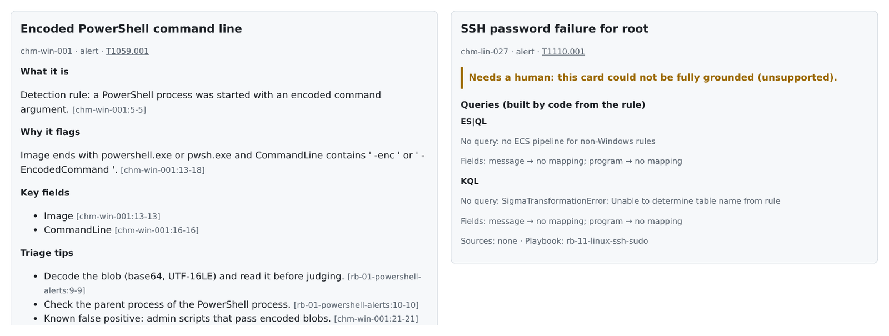

# runbook-cards

Turn long, messy detection rules and help-desk runbooks into one short, checked card each, in a single static HTML file you can open from disk. For a fictional MSSP, Calder Health. All data is synthetic.



**Every one of the 249 fields that reached a card is backed by a verified quote · 16 of 30 security rules refused as "needs human" instead of guessed · help desk 15 / 15 · $1.58 for 45 cards** (one recorded run)

## The problem
A tier-1 analyst or help-desk agent has about 60 seconds per ticket. The rule or SOP behind it is long and written for its author. A model can summarise it, but a summary nobody can check is a new risk: one invented step is worse than no runbook.

## 30-second quickstart (no key, $0)
```
python3 -m venv .venv
.venv/bin/pip install --require-hashes -r requirements-dev.lock && .venv/bin/pip install --no-deps -e .
.venv/bin/runbook-cards demo
```
Windows: use `.venv\Scripts\` instead of `.venv/bin/`. `demo` builds `site/security.html` and `site/helpdesk.html` from the committed cards. More: [docs/usage.md](docs/usage.md).

## How it works
```
sources (rules, runbooks)  ->  pack (one unit per rule / SOP)
  -> Claude writes the prose; each field carries spans {doc, lines, quote}
  -> span check (is the quote really in those lines?) + grounding check (does it support the sentence?)
  -> static card page, or "needs human" with the reason
```
- A **unit** is one rule or SOP; a **pack** is a set of units. Two packs share one engine: **security** (30 Sigma rules, an open detection-rule format) and **helpdesk** (15 SOPs).
- A **span** is a quote plus the document and line numbers it came from. A field with no verified span never reaches a card.
- The model writes prose only. Queries (ES|QL, KQL) come from pySigma, a Sigma-to-query library; titles, ATT&CK ids and links are built by code.
- A unit that fails the checks twice becomes a "needs human" card. The page is one escaped file with a script-hash CSP, safe from `file://`.

## Result
One recorded run: `claude-sonnet-5-5`, 45 units, **$1.58** in total (about $0.035 per card). Table: [evals/results/live-1.md](evals/results/live-1.md); `runbook-cards eval --replay evals/recorded/live-1` re-scores it offline.

| Measure | Security (n = 30 rules) | Helpdesk (n = 15 SOPs) |
|---|---|---|
| Key fields present in the rule / precision and recall vs answer key | 14 / 30; P 1.0, R 0.481 | n/a; steps in range 15 / 15 |
| Conversion success, ES\|QL and KQL (deterministic) | 27 / 30, 22 / 30 | n/a |
| ATT&CK ids equal the answer key (built by code) | 30 / 30 | n/a |
| Escalation target equals the expected result | n/a | 15 / 15 |
| Fields whose spans pass the span check (deterministic) | 91 / 91 | 158 / 158 |
| Unsupported claims (model grounding check), before -> after one redraft | 29 -> 16 | 3 -> 0 |
| Cards containing a phrase the expected result forbids | 0 | 0 |
| Cards marked "needs human" | 16 (error 5, unsupported 7, validator 4) | 0 |
| Red-team set (n = 6, inside the units above): injection reported / instruction followed | 4 / 6, 0 / 6 | (same row) |
| Cost per card, total $ | $0.0352, $1.5826 | (same run) |

**Honest results line:** the 14 passing security cards are checked, but 16 of 30 rules got no card. That is the pipeline saying "I am not sure", not a bug to hide; the three causes are in the [pilot readout](docs/pilot-readout.md): error (a reply that could not be used), unsupported (a sentence that still lacked support after one redraft), validator (a reply that broke the card rules twice).

## Honest limits
- Sources are synthetic; real runbooks are messier. Nothing here says anything about real-world accuracy.
- The grounding check is a second model call and can be wrong both ways; the span check is the only deterministic proof.
- Not every rule converts to every query language (the table counts them).
- No human spot check yet; planned: 20 cards read by the author.
- Strict tool schemas are off (the API refused the card schema as too large); our own validator checks every reply instead. Detail in [docs/decisions.md](docs/decisions.md).
- One live run, one prompt version, one model: a single recording, not an average. Python 3.11 is the lowest supported version.

## More
[Usage and live mode](docs/usage.md) · [Brief](docs/brief.md) · [Pilot readout](docs/pilot-readout.md) · [Decisions](docs/decisions.md) · [Security](SECURITY.md) · [Third-party](THIRD_PARTY.md) · [License](LICENSE)

Designed, specified and reviewed by me; most code written by Claude Code agents I directed.
